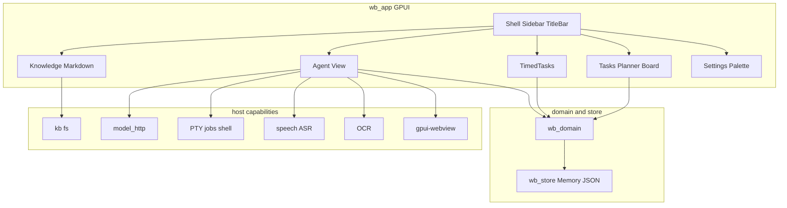

# 全量 Rust + gpui-kit 重构计划

## 决策（已锁定）

- **栈**：去掉 Node/Tauri/WebView 前端；整仓改为 Cargo workspace。
- **UI**：[`gpui-kit`](D:\codehub\gpui-kit)（本地 path：`../gpui-kit/crates/kit`），启动模式对齐 [`examples/ai_recipes/src/bootstrap.rs`](D:\codehub\gpui-kit\examples\ai_recipes\src\bootstrap.rs) 与 [`examples/sidebar`](D:\codehub\gpui-kit\examples\sidebar)。
- **目标**：功能与 [`README.md`](README.md) / [`docs/design.md`](docs/design.md) 对齐（任务、定时、知识库、Agent、语音/OCR、通知、设置等），不是 MVP 裁剪。
- **数据**：继续读写 `%APPDATA%\my-workbench\` 下现有快照与偏好，避免用户数据迁移断裂。

## 目标架构



| Crate | 职责 | 主要来源 |
| --- | --- | --- |
| `wb-domain` | 无 IO 领域：任务规则、快速捕获、重复、定时、提醒、Agent 契约 | [`packages/domain`](packages/domain) |
| `wb-store` | 内存仓储 + JSON/SQLite 落盘、防抖保存、滚动备份 | [`packages/db`](packages/db) + [`apps/desktop/src/lib/persistence.ts`](apps/desktop/src/lib/persistence.ts) |
| `wb-host` | 原 Tauri 原生能力（去 invoke）：kb、speech、ocr、agent_workspace、model_http、fonts | [`apps/desktop/src-tauri/src`](apps/desktop/src-tauri/src) |
| `wb-agent` | 回合循环、工具分派、审批、provider、skills/plugins/MCP | [`apps/desktop/src/agent`](apps/desktop/src/agent) |
| `wb-app` | gpui-kit 窗口与全部界面 | 现 React UI + kit Sidebar/List/Input/Dialog/Markdown/Editor |

根目录新增 `Cargo.toml` workspace；`gpui-kit` 用 path：

```toml
gpui-kit = { path = "../gpui-kit/crates/kit" }
```

需要网页会话时额外依赖 path：`../gpui-kit/crates/webview`。

## 仓库替换范围

**删除 / 停用**：`apps/desktop`（React + Vite + Tauri）、`packages/*` npm 包、根 `package.json` workspaces、与 Node 绑定的 `npm run check` 门禁。

**保留并改写**：产品文档（更新栈描述）、数据路径约定、版本号 `0.1.x` 续写、图标/资源。

**新门禁**（替换 `.cursor/rules/commit-gate.mdc`）：

```bash
cargo fmt --check && cargo clippy --workspace -- -D warnings && cargo test --workspace
```

## 实现顺序（按可运行切片推进，最终全量对齐）

### 阶段 0 — 脚手架与壳

- 建立 workspace 与 `wb-app`：`gpui_kit::application()` → `init` → `open_window`。
- 用 kit `Sidebar` / `TitleBar` 风格搭出导航：今日、收件箱、已完成、计划、定时、项目、知识库、Agent、设置（参考现 [`Sidebar.tsx`](apps/desktop/src/shell/Sidebar.tsx) 信息架构）。
- Windows 打包骨架（exe + 资源目录），先能 `cargo run -p wb-app`。

### 阶段 1 — 领域与持久化

- 将 [`types.ts`](packages/domain/src/types.ts) 与不变量（dueDay/dueWithTime 互斥、今日规则、完成清提醒等）迁到 `wb-domain`，用 serde 对齐 JSON 字段名。
- `wb-store`：hydrate/save `workbench.json`、`.tmp` 原子写、滚动 `workbench.bak.*`、可选 SQLite 主路径（现 [`persistence.ts`](apps/desktop/src/lib/persistence.ts) / [`wbdb.rs`](apps/desktop/src-tauri/src/wbdb.rs)）。
- `prefs.json` / `theme.json` / credentials 读写迁到 Rust。

### 阶段 2 — 任务与计划

- 列表 / 看板 / 统计、任务编辑、子任务、标签、计时、快速捕获、`Ctrl+N`。
- 计划时间线、提醒扫描（15s）与通知中心铃铛。
- 虚拟列表用 kit `List`。

### 阶段 3 — 定时任务

- 节奏模型与 UI（预设/自定义）、立即执行 / 跳过、到期投递到 Agent（依赖阶段 5 接通前先写入通知与队列）。

### 阶段 4 — 知识库

- 迁 `kb.rs` 到 `wb-host`（目录选择、读写、扫描、reveal、git branch）。
- 文件树 + Markdown：优先 kit `markdown` / `editor`（参考 gpui-kit `examples/markdown`、`examples/editor`）；模式 live/source/preview。
- 查找替换、快速打开；库根偏好改存 prefs（不再用 localStorage）。

### 阶段 5 — Agent

- Provider、密钥、`model_http`、回合与工具门禁（confirm / session_auto / readonly）。
- 工作台工具 + 工作区工具；PTY/job/shell 从现 `agent_workspace.rs` 接入。
- 技能/插件/MCP/钩子/子智能体设置页。
- 网页会话：`gpui-webview` 替代 Tauri `web_session`（Agent 页 URL 栏 + 嵌入 WebView；离页隐藏）。

### 阶段 6 — 语音 / OCR / 其它原生

- speech 模型目录/下载；CapsLock LL hook + cpal 录音写 `ptt-last.wav`；转写走 sherpa-onnx CLI（Windows 与 OCR 的 MT/MD CRT 冲突，暂不同进程链接）。
- PaddleOCR 模型下载 + 内置 paddle-ocr-rs ONNX（tesseract / CLI 回退）。
- 系统字体扫描、HTTP 代理、`.wb/spill` 落盘与 30 天 GC；MCP HTTP JSON-RPC/SSE。
- 子智能体：`wait=true`/`send_message` 走完整 `run_user_turn` 工具环；异步托管后台 resume。

### 阶段 7 — 收尾

- 命令面板 `Ctrl+P`/`Ctrl+K`：页面/任务/项目/会话/笔记 + 知识库文件。
- 深浅色主题（`Theme::change`）、侧栏折叠 + 拖拽改宽持久化；设置页可编辑 MCP/子智能体/Hooks JSON。
- 更新 README / design / packaging / 提交门禁；移除全部 JS 依赖与 Tauri 配置。

## 关键复用策略

- **直接搬迁**：[`apps/desktop/src-tauri/src`](apps/desktop/src-tauri/src) 中 kb/speech/ocr/agent_workspace/model_http/fonts/shell_env — 去掉 `#[tauri::command]`，改为 `wb-host` 普通 API，由 `wb-app`/`wb-agent` 调用。
- **语义移植**：`@wb/domain` 纯函数用 Rust 重写并保持单元测试用例语义一致（从 `packages/domain/tests` 对照）。
- **UI 重写**：React 组件不逐文件翻译；按视图用 gpui-kit 组件重建，交互与快捷键保持产品语义。

## 风险与约束

- gpui-kit 0.10 + `gpui-pre 0.3.12` API 变动频繁：只依赖本地 path，不混用 crates.io 旧版本。
- Agent/语音/OCR 体量大：按阶段合入，但仓库从阶段 0 起即不再以 Tauri 为主路径。
- JSON 字段名与空值语义必须与现快照兼容；加集成测试用样例 `workbench.json` 做 round-trip。
